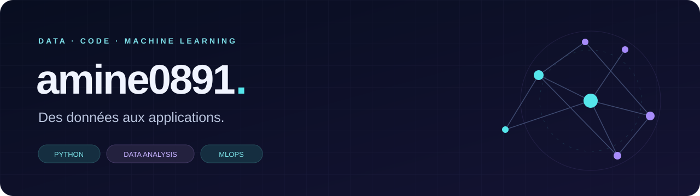

  

<h1 align="center">Bienvenue dans mon univers data 👋</h1>

  <b>Collecter. Explorer. Modéliser. Construire.</b> 
  Des projets autour de Python, de l’analyse de données et du machine learning.

  <a href="https://github.com/amine0891?tab=repositories"><b>Explorer mes projets →</b></a>

---

### À propos

Je m’intéresse au parcours complet de la donnée : **collecte, analyse, visualisation et applications**. Mes dépôts explorent notamment le scraping d’offres d’emploi en Tunisie, la prévision des ventes et les pipelines d’analyse de texte.

J’aime relier le code à un cas d’usage concret, avec une place particulière pour **Python**, les interfaces **Streamlit** et les démarches **MLOps**.

### Ma boîte à outils

### Projets à découvrir

<table>
  <tr>
    <td width="50%" valign="top">
      <h3>01 · Analyse de texte</h3>
      
<b><a href="https://github.com/amine0891/tx-analyzer">TX Analyzer ↗</a></b>

      
Un pipeline de collecte d’articles et d’analyse de toxicité.

      
<code>Python</code> · <code>NLP</code>

    </td>
    <td width="50%" valign="top">
      <h3>02 · Données &amp; emploi</h3>
      
<b><a href="https://github.com/amine0891/job-offers-scraping-tunisia">Job Offers · Tunisia ↗</a></b>

      
Collecte et visualisation d’offres d’emploi d’Emploitunisie par domaine et localisation.

      
<code>Python</code> · <code>Streamlit</code> · <code>Scraping</code>

    </td>
  </tr>
  <tr>
    <td width="50%" valign="top">
      <h3>03 · Prévision des ventes</h3>
      
<b><a href="https://github.com/amine0891/MLOPS--Sales-Forecast">Sales Forecast ↗</a></b>

      
Un projet consacré à la prévision des ventes et à l’exploration du MLOps.

      
<code>Jupyter</code> · <code>Forecasting</code> · <code>MLOps</code>

    </td>
    <td width="50%" valign="top">
      <h3>04 · Explorations</h3>
      
<b>NLP &amp; Big Data</b>

      
Des projets dérivés pour explorer la <a href="https://github.com/amine0891/Tunisian-Dialect-Abusive-Language-Detection">détection de langage abusif en dialecte tunisien</a> et la <a href="https://github.com/amine0891/Fraud-Detection-with-Real-Time-Big-Data-Processing">détection de fraude en temps réel</a>.

      
Forks de projets de <a href="https://github.com/Pysham0n">Pysham0n</a> ; les auteurs d’origine restent crédités dans les dépôts.

    </td>
  </tr>
</table>

---

  <b>Une idée, des données, un projet à construire ?</b> 
  Retrouvez mon travail dans <a href="https://github.com/amine0891?tab=repositories">mes dépôts GitHub</a>.

